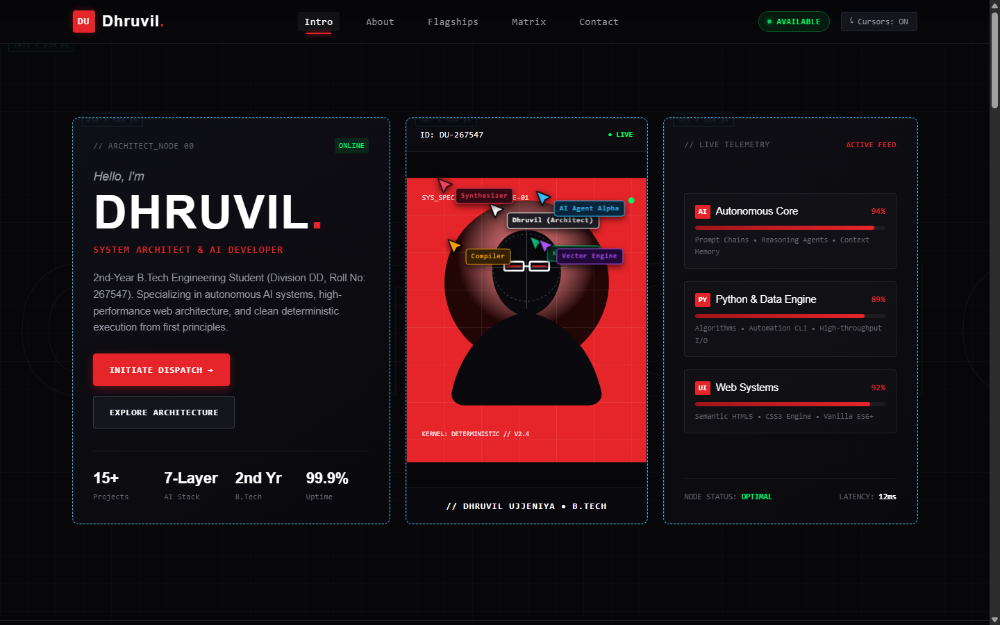

# Dhruvil_267547_Portfolio

A personal developer portfolio engineered from scratch with an **Obsidian & Crimson** cyber-editorial aesthetic and interactive CAD wireframe blueprint states.

---

## 👨‍💻 Engineering Profile
- **Developer:** Dhruvil Ujjeniya
- **Academic Role:** 2nd-Year B.Tech Engineering Student
- **Division:** DD
- **Roll Number:** 267547
- **Role & Focus:** System Architect & AI Developer

---

## 🚀 Overview & Key Features

This portfolio is built entirely from first principles without relying on heavy frontend frameworks, UI kits, or external script bundles. It delivers high-fidelity visual interaction and fluid performance through native web standards.

- **Figma-Style CAD Wireframe Blueprint Reveal:** Interactive scroll-assembly animation where components briefly display cyan CAD bounding boxes and live pixel dimension tags (`width × height px`) before settling into the Obsidian & Crimson aesthetic.
- **Collaborative Multi-Cursor Swarm:** 6 autonomous agent cursors with specialized system roles orbiting and tracking viewport activity in real time, toggleable via the header control.
- **3-Column Hero Bento Grid:** High-contrast developer silhouette SVG card, live hardware/runtime telemetry progress indicators, and core architectural statistics.
- **Interactive 7-Layer Architecture Tabs:** Dynamic exploration interface for the flagship project (*Molecular Mentor*), showcasing layers from hardware acceleration (`L0`) to telemetry interface (`L6`).
- **Dynamic Systems Matrix Filter:** Client-side category filtering for core technical competencies across Web, Python/AI, and Developer Tooling.
- **Client-Side Validated Direct Dispatch Form:** Inline instant validation engine enforcing clean input standards and responsive feedback loops.
- **Fully Responsive Architecture:** Custom CSS media queries for desktop (`1440px`), tablet (`960px`), and mobile (`390px`) viewports with zero horizontal overflow.

---

## 🛠️ Technologies Used

- **HTML5:** Semantic document architecture (`<header>`, `<nav>`, `<section>`, `<article>`, `<main>`, `<footer>`, `<form>`) with accessibility attributes.
- **CSS3:** Custom design tokens, CSS Grid, Flexbox, hardware-accelerated animations, CAD wireframe states, and responsive media queries.
- **Vanilla JavaScript (ES6+):** Zero-dependency motion engine, `IntersectionObserver` scroll triggers, multi-cursor mathematics, DOM tabs, and state filtering.

---

## 📸 Portfolio Preview



---

## 📂 Project Architecture

```text
Dhruvil_267547_Portfolio/
├── index.html       # HTML5 Semantic structure & layout
├── style.css        # Obsidian & Crimson styling, wireframe states, and media queries
├── script.js        # Vanilla ES6+ animations, cursor swarm, tabs, filter, and form validation
├── screenshot.png   # Full desktop portfolio preview capture
└── README.md        # Documentation and technical summary
```

---

*Engineered with deterministic precision by Dhruvil Ujjeniya (Roll No: 267547).*
